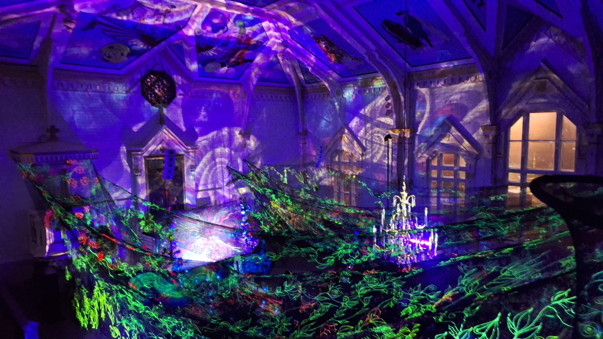
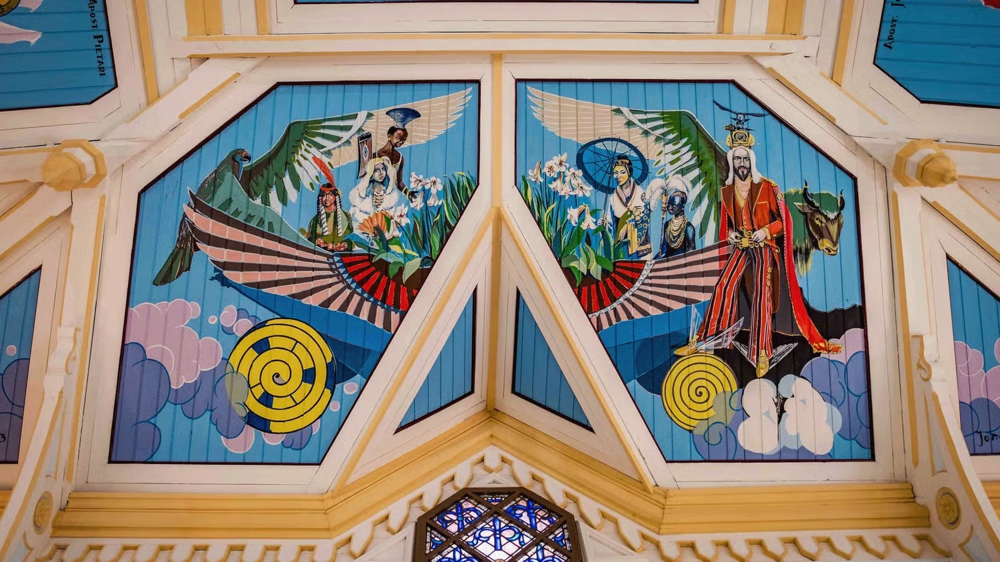
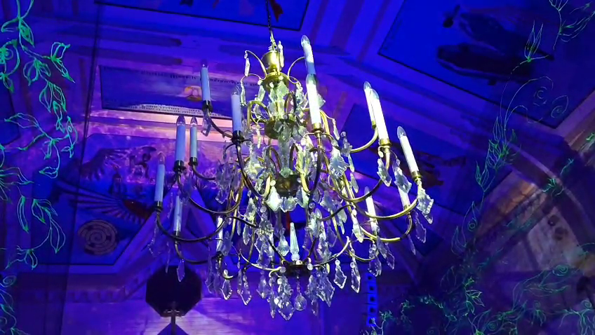
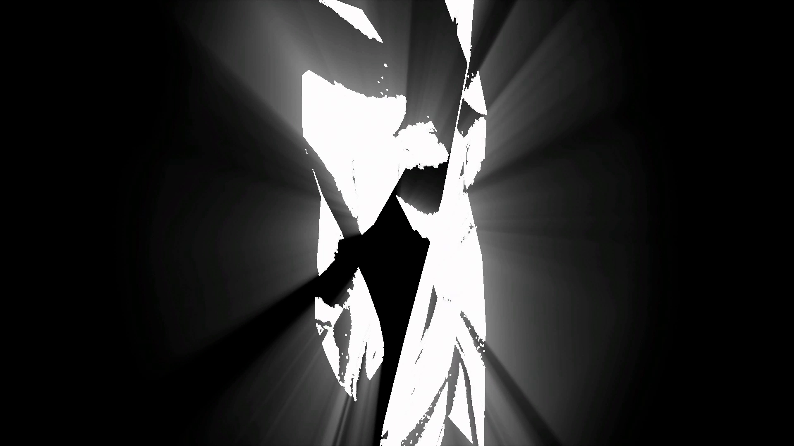
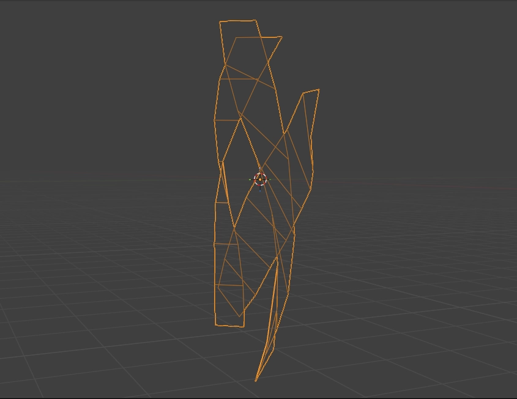
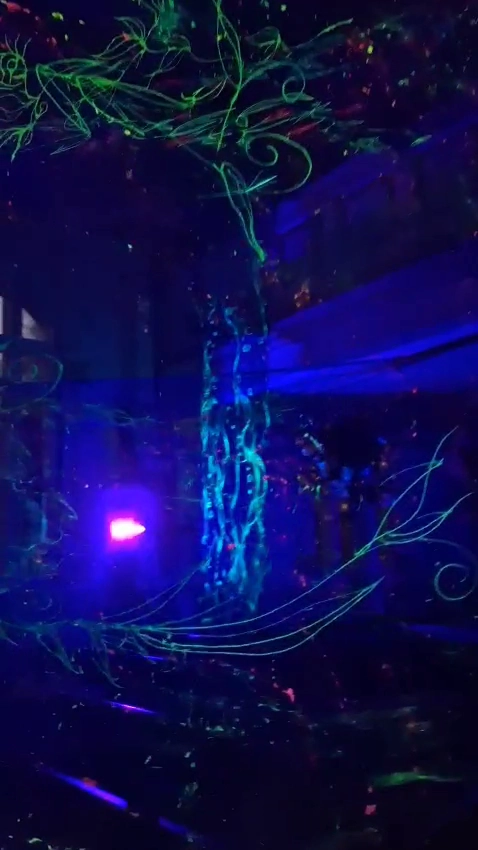

Light Art And Video Installation in A Village Church

1 VIRTA Installation, photo from Riikka Arte
 

Virta was a collaborative installation work created by <a target="_blank" href="https://www.riikkaarte.com/"> Riikka Arte </a>, <a target="_blank" href="https://www.instagram.com/sirmichaelmadness/"> Sir Michael Madness </a>, from the deco team <a target="_blank" href="https://www.instagram.com/avaruusdiscodeco/"> Avaruus Disco </a> and myself. We were given creative liberty to build a light and UV-paint installation in the <a target="_blank" href="https://www.toivakka.fi/en/front-page/to-see/"> Toivakka Church </a> . When planning concepts, Rika Arte and I were both interested by the potential of video mapping onto UV-painted fabrics. Additionally, we all kept returning to a theme of water, somehow the installation should feel like an underwater space.
  
The Toivakka church has unique paintings created by Pellervo Lukumies. My first impression of the paintings was 70s progressive rock music such as King Crimson and Rush. Typically I design content to accompany a DJ performance and fit the energy of the event. While the Virta installation featured an ambient track, I decided that at least the visuals should also feel like they fit to progressive rock music.
  

2 Photo from  <a target="_blank" href="https://yle.fi/aihe/a/20-276984#&gid=0&pid=39-5144895bb656d01e419"> Yle / Eva Pursiainen </a>   Some of Pellervo Lukumies' paintings in the Toivakka Church

 

Working as a media designer you are often responsible for deciding the entire AV technology setup of the event. This is a skill that requires some experience to get a feel for, entering a space and deciding, what effect your trying to achieve, where everything should be positioned, and how it will actually be setup and taken down. What would both complement the UV-painted fabrics and bring energy and a nice feeling to the space. Will the light beam from the projectors be annoying? What is the limitations of the projectors? Typically there is very limited time to decide all of these factors.

  

We planned that the projectors should be placed near to the central alter. Sir Michael Madness’ video work would be projected onto the walls and ceiling of the church and we would setup rows of UV-painted fabrics above it, which provided a central point for the installation and also diffused some of the light from the projectors below them. 
  

When we visited the church I noticed an ornate chandelier hanging from the ceiling in the middle of the room, I knew that this feature needed to be highlighted. We setup another projector upstairs in the church and I sent a weaving flowing pattern onto chandelier. I set the video loop on approximately a 30 second timer, so it would fade out and in. When the video came on the chandelier illuminated the whole space and sent flowing floral shadows from the ornate decorations downwards toward the central alter. When the loop faded out it provided a relief, and contrast to balance the effect.

3 Screenshot from video by Riikka Arte

 

These sorts of loops are created by taking a texture image, usually a digital painting then applying them to a 3D object, like a thin twisted sheet in Blender, and then animating both the movement of the object  and the UV coordinates of the texture image, so it flows over the object. After this I applied lighting effects, such as different bloom variations to make the animation more radiant.
  

4 Screenshot of the video loop projected over the chandelier

5 Source 3D model in Blender

The exhibition also featured a workshop day for local schoolchildren. Rika Arte taught a UV-painting workshop and I led a sort of analog video mapping workshop. We had many objects with interesting optical properties, such as glasses, different plastic filters, prisms, thin fabrics. By shining a flashlight through these objects it’s easy to create pretty patterns and effects. A “video mask” to fit a pattern to a surface can even be constructed out of paper. The students were playing with creating patterns from these objects around the church.
  
The main point I was trying to convey in the workshop is that, creating interesting patterns and effects is relatively easy. With only a flashlight and a glass you can do a lot for decorating and modifying a space. The animation I created for Virta started as a digital painting. You can easily take your art and turn it into a video installation or add a layer of textures onto an art piece.
  
In the next iteration of the workshop, I would like allow students to make their own images, and then use their photos as the texture source on a 3D object, and have the students be able to see the output of a projector decorating a space with their own works.
  
  
If your interested in taking lessons to learn about 3D modelling, media design, audio-reactive content, VJing, you can contact me and setup a time through the following link.
  
<a target="_blank" href="https://twilightcourier.gumroad.com/l/vj_lesson?layout=profile"> Book Lessons through Gumroad </a>

6 Screenshot from video by Riikka Arte

 

